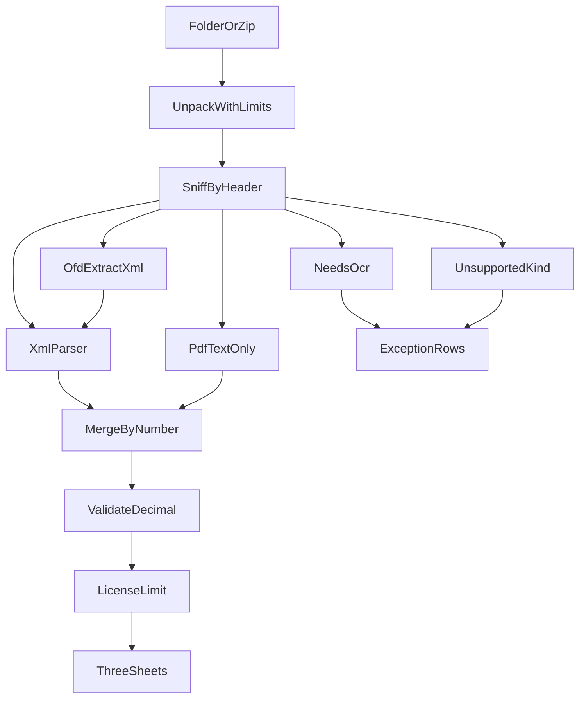

# 发票成表详细开发计划

依据仓库根目录 [开发计划.md](开发计划.md) 展开。本文是实现说明，原计划保持不动。编码须另一次明确开工，并严格按阶段 0 到阶段 8 推进，前一阶段完成标准未满足时不进入下一阶段。

产品名「发票成表」，窗口标题「发票成表 — 数电票整理成 Excel」。包名 `fapiao`。第一屏固定三句：文件只在这台电脑处理；结果用于整理，不代替税务局查验；本工具不核验数字签名，入账归档仍要保存原始 XML。

## 目标与边界

本地 Windows 10/11 工具，把已下载的数电发票文件夹或 `.zip` 整理成三张 Excel：发票汇总、商品明细、异常。同一套逻辑提供命令行。断网可处理已下载文件。原始发票不改名、不移动、不修改时间。

第一版做到：按文件头识别格式；解析增值税数电专用发票与普通发票 XML（英文标签与拼音缩写标签）；OFD 只取内嵌发票 XML；PDF 只读文字层中的 20 位发票号码和价税合计；按发票号码去重且有 XML 时以 XML 为准；Decimal 勾稽；手填税号按进项或销项过滤；红字保留负号；免费每次最多 5 张合格票进入汇总；本地授权文件取消张数限制。

第一版范围止于上述整理。不连接电子税务局，不开票，不查验，不上传。验签状态恒为「未验签」。图片与扫描件进异常，原因码 `NEEDS_OCR`。铁路电子客票、航空运输电子客票行程单、财政票据识别后拒绝，原因码 `UNSUPPORTED_KIND`。不做会计科目、纳税申报、用友或金蝶导入模板、网站、账号与云端计费。不引入数据库、Web 框架、Electron、OCR 和视觉模型。

## 技术与目录

Python 3.12。依赖只使用：`lxml`、`pypdf`、`openpyxl`、`customtkinter`；开发依赖 `pytest`、`pyinstaller`。金额只用 `decimal.Decimal`。窗口禁止再写解析，只收集参数并调用与命令行相同的 `run`。

```text
invoice-to-table/
  开发计划.md
  详细开发计划.md
  README.md                 阶段 6 再写安装与样本跑法
  pyproject.toml            src 布局，包名 fapiao
  src/fapiao/
    __init__.py
    __main__.py             python -m fapiao
    sniff.py
    unpack.py
    models.py
    parsers/xml_parser.py
    parsers/ofd_parser.py
    parsers/pdf_parser.py
    validate.py
    merge.py
    pipeline.py
    export_xlsx.py
    license.py
    cli.py
    ui.py
  tests/
  samples/                  脱敏样本；真实下载包不提交
  scripts/dump_tags.py      也可作为 fapiao dump
```

`pyproject.toml` 使用 setuptools `src` 布局，`requires-python >= 3.12`。私钥、真实税号、真实下载包列入 `.gitignore`。

## 处理流程



解压限制：单个压缩包不超过 200MB；单个内部文件不超过 20MB；解压总字节不超过 200MB；嵌套不超过 5 层；成员数不超过 2000。解压目标必须落在临时目录内，拒绝绝对路径和 `..`。失败给出原因，不写出包外文件。处理结束后删除临时目录。

分流：

- XML 走 `xml_parser`，解析级别 `xml`
- ZIP 根目录含 `OFD.xml` 视为 OFD：递归查找含 `EInvoice` 或 `EInvoiceData` 的 XML，再走同一解析器，解析级别 `ofd-xml`；找不到则为 `OFD_NO_XML`
- 其他 ZIP 递归列出内部文件并按文件头分流
- PDF 只提取号码和价税合计，解析级别 `pdf-only`；文字层为空则 `NEEDS_OCR`
- 图片（JPEG、PNG、GIF、BMP、WEBP、TIFF）为 `NEEDS_OCR`
- 铁路、航空、财政票据为 `UNSUPPORTED_KIND`
- 无法识别的文件为 `UNKNOWN_FILE`，不进入汇总。这是对原因码表的必要补充，避免静默丢文件

正式汇总只收解析级别为 `xml` 或 `ofd-xml`、且规则通过的票。`OK` 与 `RED_INVOICE` 可进汇总。其余原因码只进异常表。

## 数据模型

[src/fapiao/models.py](src/fapiao/models.py) 用 dataclass。金额字段类型为 `Decimal`，解析时按两位小数 `ROUND_HALF_UP` 量化。比较时允许绝对差额不超过 `Decimal("0.01")`。

一张票：

- 发票号码：20 位数字，去重主键
- 开票日期：`YYYY-MM-DD`。接受 `YYYY-MM-DD`、`YYYYMMDD`、带时间的日期、`YYYY年MM月DD日`，统一截成日期
- 发票票种：`专用` 或 `普通`
- 是否红字：价税合计为负，或票面标明红字。金额保持原值，程序不自动取反。标明红字但价税合计为正时，不进入汇总，异常说明写「红字标记与金额符号不符」
- 购买方名称、税号；销售方名称、税号
- 合计金额（不含税）、合计税额、价税合计
- 开票人：可空
- 来源文件：合并后可多个
- 解析级别：`xml` / `ofd-xml` / `pdf-only`
- 验签状态：恒为「未验签」
- 明细列表

明细一行：项目名称、规格型号、单位、数量、单价、金额、税率、税额、税收分类编码、编码状态。税收分类编码应为 19 位数字；缺失或不是 19 位数字时，该行编码状态为「编码缺失」，整票不因此被拦截。

税号比较前去掉全部空白，字母转大写。程序不从票面猜测哪一方是本公司。

## 候选标签

每个字段一张有序候选表，匹配 XML 本地名，忽略命名空间。按列表顺序取第一个有值的节点。缺字段时用 `python -m fapiao dump 某文件.xml` 打印标签树，把缺的本地名补进候选表。不为省份或服务商复制解析函数。

阶段 2 先落地一份真实英文标签样本上出现的名字。已知常见起点（以样本为准，样本没有的名字先不写死）：号码 `InvoiceNumber`、`EIid`；后续阶段 3 再加入拼音缩写，例如 `Fphm`。买卖方、三个合计、明细行的项目名称、规格、单位、数量、单价、金额、税率、税额、税收分类编码同样各维护一组候选。

税率归一：`13%` 除以 100；`0.13` 保持小数；`免税` 与 `不征税` 税率为 0，且该行税额必须为 0。样本里若出现不带百分号的整数税率，先 `dump` 确认后再加规则。

`dump` 输出缩进的本地名与命名空间，供补候选，不复制整段解析代码。

## 合并

[src/fapiao/merge.py](src/fapiao/merge.py) 只按 20 位发票号码分组。红字与蓝字号码不同，不合并。

- 有 XML 或 OFD 内嵌 XML 时，金额、税号、明细以该 XML 为准。同一号码的 PDF 只追加来源文件，不用 PDF 金额覆盖
- 同一号码多份 XML，规范化后的号码、日期、双方税号、三个合计、明细金额与税额一致：保留一张，来源合并，多余文件记 `DUP_INVOICE`
- 两份 XML 上述字段不一致：两张都不进汇总，记 `DUP_CONFLICT`
- 只有 PDF：记 `PDF_ONLY`，不进汇总
- 号码无法确定的 PDF：仍为 `PDF_ONLY`，说明写「未能确定发票号码」

## 勾稽与原因码

[src/fapiao/validate.py](src/fapiao/validate.py) 全部用 Decimal。

1. 明细金额之和与合计金额相差不超过 0.01
2. 明细税额之和与合计税额相差不超过 0.01
3. 合计金额 + 合计税额与价税合计相差不超过 0.01
4. 每一行金额乘税率与税额相差不超过 0.01。免税、不征税的税额必须为 0
5. `--direction in`：购买方税号等于手填税号。`--direction out`：销售方税号等于手填税号
6. 去重键只有发票号码
7. 税收分类编码不是 19 位数字时，只标在明细上

折扣行、差额征税若导致 `TAX_MISMATCH`，第一版不猜测算法，整票进异常表，等真实样本再补规则。

原因码、说明、是否进入汇总：

- `OK`：勾稽和税号通过。进入汇总
- `RED_INVOICE`：红字且勾稽通过。进入汇总，金额为负；异常表同时提醒「红字发票，金额为负，请核对」
- `DUP_INVOICE`：同一号码已有合格票。不另起汇总行，合并来源
- `DUP_CONFLICT`：同一号码两份 XML 不一致。不进入汇总
- `AMOUNT_MISMATCH`：金额勾稽失败。不进入汇总
- `TAX_MISMATCH`：某行税额和税率不符。不进入汇总
- `TAX_ID_MISMATCH`：不是本公司该方向的票。不进入汇总
- `PDF_ONLY`：只有 PDF。不进入汇总
- `OFD_NO_XML`：OFD 内没有发票 XML。不进入汇总
- `NEEDS_OCR`：图片或扫描件。不进入汇总
- `UNKNOWN_SCHEMA`：XML 标签无法映射出 20 位发票号码或三个合计。不进入汇总
- `UNSUPPORTED_KIND`：铁路、航空或财政票据。不进入汇总
- `UNKNOWN_FILE`：文件头无法识别。不进入汇总
- `LICENSE_LIMIT`：超过免费额度，未写入汇总。不进入汇总

异常表按原因码排序。说明使用上面的中文短句，阶段 8 前请会计改掉看不懂的句子，再冻结文案。

## Excel、额度与授权

默认文件名 `进项_YYYYMMDD.xlsx` 或 `销项_YYYYMMDD.xlsx`。同一天再次运行覆盖该结果文件，不覆盖原始发票。金额列为数值，税率列为百分数。

发票汇总列：发票号码、开票日期、票种、是否红字、购买方名称、购买方税号、销售方名称、销售方税号、合计金额、合计税额、价税合计、开票人、来源文件、解析级别。

商品明细列：发票号码、开票日期、项目名称、规格型号、单位、数量、单价、金额、税率、税额、税收分类编码、编码状态。

异常列：文件名、发票号码、原因码、说明、解析级别。表头或首页说明保留「未验签、不查验」。

汇总内合格票按开票日期、发票号码稳定排序。免费版取排序后的前 5 张写入汇总，其余合格票改记 `LICENSE_LIMIT`。付费授权不写这一行。异常表始终完整写出。

授权文件放在程序目录，JSON 字段：产品名、授权对象、到期日、席位数、Ed25519 签名。公钥嵌在程序内，私钥只留在发行侧，不进仓库。启动时只校验签名和到期日，不联网，不绑定机器码。席位数字段保留，第一版不在运行时点数。签名无效或已过期时按免费版限额运行，关于页显示免费。有效授权显示到期日。

人工用微信或支付宝收款后发放授权文件。买断含 12 个月规则更新。第一版不自建支付后台。

## 命令与窗口

```text
python -m fapiao run ./下载包 --tax-id 9133XXXXXXXXXXXX --direction in --out 进项_20261008.xlsx
python -m fapiao dump ./某一张.xml
```

`--direction` 只接受 `in` 或 `out`。未给 `--out` 时用默认文件名。税号空白时命令行以非零退出，窗口禁止开始。

[src/fapiao/pipeline.py](src/fapiao/pipeline.py) 提供唯一入口 `run(path, tax_id, direction, out) -> RunResult`，返回合格张数、异常张数、输出路径。CLI 与窗口都调用它。

窗口用 customtkinter，只有：选择文件夹、本公司税号、进项或销项、开始。结束后显示两张计数并打开 Excel。关于页放三句边界和授权状态。

打包为一个 exe：无参数启动窗口；参数为 `run` 或 `dump` 时走命令行。目标机器不安装 Python。

## 阶段与完成标准

### 阶段 0：样本与仓库骨架

初始化 git 与 `pyproject.toml`，建立空包和 `tests`。准备 8 类脱敏样本并写 [samples/README.md](samples/README.md)：英文标签 XML、拼音标签 XML、带内嵌 XML 的 OFD、同一张票的 PDF、红字票、重复文件、税务局混合压缩包、手机照片。每张记录文件名、期望发票号码、价税合计、期望原因码。入库税号中间位打码。另备一个路径逃逸压缩包，只用于解压测试，不伪装成真实发票。

完成标准：`pytest` 能启动；8 类样本都有期望值。没有样本时不开始解析器。

### 阶段 1：格式识别与解压

实现 [src/fapiao/sniff.py](src/fapiao/sniff.py) 与 [src/fapiao/unpack.py](src/fapiao/unpack.py)。文件头判断 XML、ZIP、PDF、图片。ZIP 根目录含 `OFD.xml` 标为 OFD，否则标为普通压缩包。混合压缩包递归列出类型。超限或路径逃逸时失败。

完成标准：样本压缩包能列出每个内部文件的类型；照片标为图片；恶意路径不会写到临时目录外面。

### 阶段 2：一张英文标签 XML

实现 `models.py` 与 `parsers/xml_parser.py` 的第一组标签。

完成标准：该样本的号码、买卖方税号、三个合计、每一行明细与 `samples/README.md` 一致。

### 阶段 3：候选标签

把阶段 2 的标签放进候选表，再解析拼音标签样本。缺字段只用 `dump` 补候选。

完成标准：两套 XML 得到同一结构。测试只断言字段值。

### 阶段 4：勾稽

实现 `validate.py`。测试内构造三张假票：明细金额少 1 元、税率算错、购买方税号错误。假票只存在于测试代码，不写入 `samples/` 对外提供。

完成标准：真实样本通过；三张假票分别为 `AMOUNT_MISMATCH`、`TAX_MISMATCH`、`TAX_ID_MISMATCH`。

### 阶段 5：OFD、PDF 与合并

实现 `ofd_parser.py`、`pdf_parser.py`、`merge.py`、`pipeline.py`。

完成标准：OFD 与对应 XML 的号码和价税合计相同；无内嵌 XML 的 OFD 得到 `OFD_NO_XML`；同一号码的 XML 加 PDF 只有一张票、两个来源、金额未被 PDF 覆盖；单独 PDF 为 `PDF_ONLY`；照片为 `NEEDS_OCR`。

### 阶段 6：Excel、额度与命令行

实现 `export_xlsx.py`、`license.py`、`cli.py`、`__main__.py`。此时写 README：如何安装、如何跑样本。

完成标准：对样本目录运行 `run` 后，合格张数、异常张数与样本说明一致；金额列可在 Excel 中求和；原文件修改时间不变；无授权时第 6 张合格票变为 `LICENSE_LIMIT`。

### 阶段 7：窗口与打包

实现 `ui.py`，PyInstaller 打出单个 exe。在一台没有 Python 的 Windows 10/11 上断网跑样本压缩包。

完成标准：双击、选文件夹、填税号，得到与命令行相同的 xlsx。窗口没有第二套解析逻辑。若杀毒软件误报，改为绿色目录交付，不要求用户关闭杀毒软件。

### 阶段 8：真实包试跑

找一位会计，用本月真实下载包断网运行。只核对三件事：合格票有没有被误放进异常、异常票有没有混进汇总、价税合计是否与税务局页面一致。不一致时先 `dump` 补标签，不先改界面。

完成标准：下面六条全部通过。

1. 有 XML 的票，价税合计与税务局清单一致
2. 重复下载的同一号码只出现一行
3. 购买方或销售方不是本公司该方向的票，不在汇总表
4. 红字为负数，且能筛选
5. 只有 PDF 或照片的文件在异常表，汇总金额不因此增加
6. 原始发票的修改时间不变

六条通过后可以把 exe 交给会计试用。列名映射、验签、铁路和航空客票不进入第一版承诺。

## 里程碑

- M0：本计划与 8 类样本期望值写明
- M1：阶段 1 至阶段 5 的测试通过
- M2：阶段 6 通过，会计可用命令行跑脱敏样本
- M3：阶段 7、阶段 8 通过，exe 断网处理真实包
- M4：至少一位会计因为超过免费额度完成一次付款，并拿到授权文件

M3 之前不制作付费模板，不增加票种，不改产品名称。

## 开工前核对

默认进项和销项都做，用 `--direction` 切换。手填税号，禁止自动猜测本公司。用会计现用的用友或金蝶粘贴表对照三张表已有列，未覆盖的列保持空白。确认办公室电脑允许未签名 exe；不允许则交付绿色目录。宣传材料使用产品边界三句，不写查验和自动入账。
